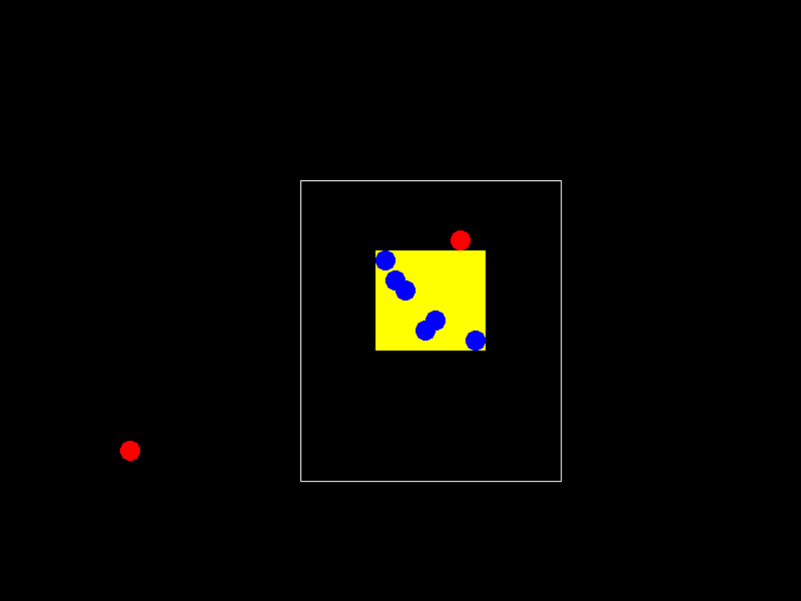

# rtg

A real-time strategy prototype from 2018: drag a box to select units, right click to send the group, which keeps its shape on the way. C++23, SFML 3.1 and kazilib.

**Play it in your browser: https://kazin.dev/projects/rtg/**



## Controls

| Input | What it does |
|---|---|
| Left drag | Select the units the box touches (they turn blue) |
| Left click | Select the unit under the cursor, or clear the selection |
| Right click | Send the selected units there; the yellow box marks where they end up |

## Building

Visual Studio 2026 (v145 toolset). FASTBuild v1.20 is found next to the checkouts or downloaded once.

```
git clone --recurse-submodules https://github.com/xkazinx/rtg.git
powershell -ExecutionPolicy Bypass -File build.ps1
```

`build.ps1` runs `setup.ps1` (the kazilib submodule, and a junction to the SFML 3.1 x86 that kazilib carries), then kazilib's FASTBuild runner on `src\fastbuild.json`: Release, x86, with the 64-bit-hosted tools. Output: `deploy\rtg.exe` with the SFML DLLs. Visual Studio builds the same from `src\rtg.sln`.

## In a web browser

The same code compiled to WebAssembly with kazilib's web port (`src\dep\kazilib\web\`, its README). The page has Scaled Window (the default), Original Size and Fullscreen under the game.

```
powershell -ExecutionPolicy Bypass -File build_web.ps1       # src\build\web\rtg-build
powershell -ExecutionPolicy Bypass -File deploy_ubuntu.ps1   # build, upload, install
```

`deploy_ubuntu.ps1` sends the build to the box `kazin-music` with `deploy\ubuntu\`: static files in `/opt/rtg/web`, served by Caddy (`/etc/caddy/sites/kazin.dev.d/rtg.caddy`). There is no server: the game runs in the page.

## Testing

`src\tests\web\run_web_test.ps1` drives the page in headless Edge through kazilib's `web\tools\browser.js`: a right click with nothing selected, box selections in both drag directions, group moves to their end, a click selecting one unit and a click clearing. `-Url https://kazin.dev/projects/rtg/` runs it on the live page. Screenshots land in `testerino\web\`.

---

## Original README (2018-11-10, 2d1cf64)

# rtg
